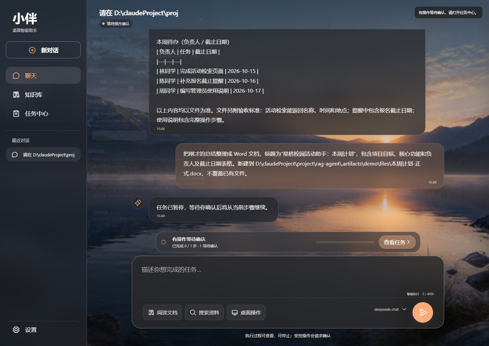

# 面试演示视频

[观看或下载演示视频](https://github.com/shij8396/desktop-agent/releases/tag/demo-video-20261013)

[直接下载 MP4](https://github.com/shij8396/desktop-agent/releases/download/demo-video-20261013/desktop-agent-demo-20261013-final.mp4)

录制于 2026-10-13，约 71 秒，静音。通过真实应用界面和本机后端，演示文件检索、文件内容分析、工具执行过程、确认后生成 Word 及实际文件内容预览。

## 已验证的流程

- 找到指定目录中的真实演示文件。
- 总结与文件中的项目目标、负责人和截止日期一致。
- 执行事件中实际出现 `find_files`、`read_file_content`、`create_docx`。
- 确认前没有生成目标文件；确认后任务恢复并完成。
- 生成的 DOCX 文件可解析，内容与源资料一致。
- 录制期间没有浏览器脚本或 API 错误。
- 修复后的本地代码通过 322 项测试、TypeScript 编译和桌面脚本检查；Tauri 桌面编译通过。

资料使用虚构校园项目，不含真实个人资料或 API 密钥。最后一屏是从实际 DOCX 直接解析的内容预览。

本次视频基于本地开发版本，上传内容为视频、预览图和说明，未同步工作区中其他未提交的源代码改动。原生桌面控制、语音、长期记忆和联网搜索未在本次视频中演示。
